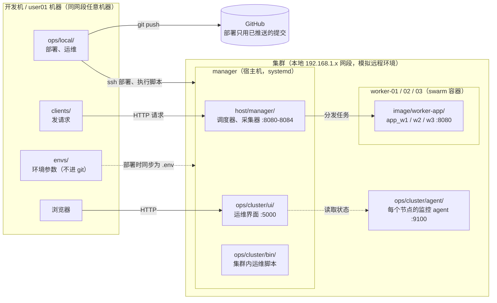
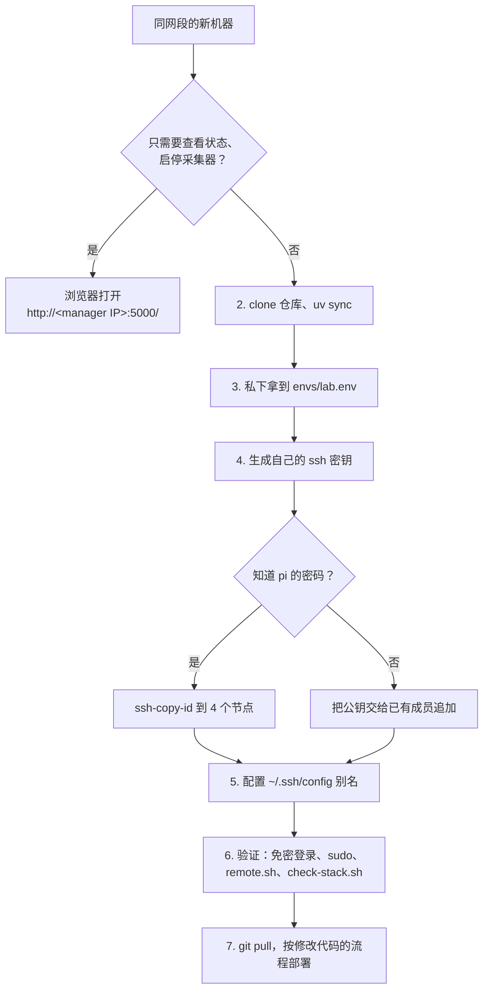
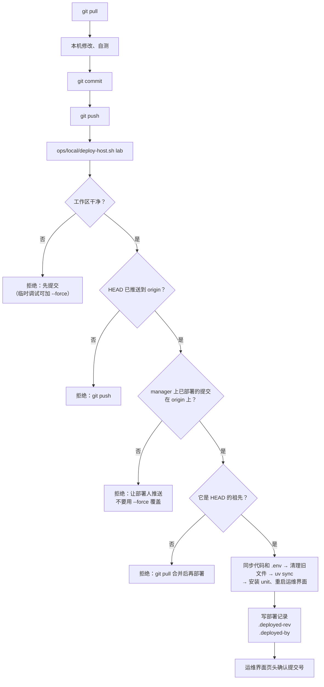

# swarm-lb

一个任务负载均衡和调度实验项目，跑在树莓派 Docker Swarm 集群上（1 个 manager、3 个 worker）。manager 上的调度器负责接收客户端请求，再按算法（RR、min_min、sd_min、DQN、RL_MOTS 等）把任务分给 worker 容器，同时采集训练数据。

- [整体结构](#整体结构)
- [目录](#目录)
- [首次使用](#首次使用)
- [环境参数](#环境参数)
- [修改代码的流程](#修改代码的流程)
- [各部分怎么部署](#各部分怎么部署)
- [多人协作](#多人协作)
- [回滚](#回滚)
- [服务与端口](#服务与端口)
- [依赖](#依赖)
- [常见问题](#常见问题)
- [待办与注意](#待办与注意)

## 整体结构



| 节点      | IP            | swarm label |
| --------- | ------------- | ----------- |
| manager   | `$MANAGER_IP` | —           |
| worker-01 | `$WORKER1_IP` | type=low    |
| worker-02 | `$WORKER2_IP` | type=middle |
| worker-03 | `$WORKER3_IP` | type=high   |

真实 IP 只记在 `envs/<环境名>.env` 里，见[环境参数](#环境参数)。线上的 stack 叫 `collect_data_stack`，包含 3 个服务 `app_w1/w2/w3`，镜像是 `$DOCKER_IMAGE`。

## 目录

目录按"代码在哪台机器上运行"划分：

| 路径                   | 在哪运行                     | 内容                                                                                               |
| ---------------------- | ---------------------------- | -------------------------------------------------------------------------------------------------- |
| `host/manager/`        | manager 宿主机（systemd）    | 调度算法 `LB_algorithm/`、调度器和采集器 `manager_*.py`、模型 `model/`、私有参数读取 `settings.py` |
| `image/worker-app/`    | worker 上的 docker 容器      | worker 服务 `app.py`、`Dockerfile`，有独立的 `pyproject.toml` 和 `uv.lock`                         |
| `image/stack/`         | swarm                        | stack 定义：`docker-compose.yaml`、`collect_data_stack.yml`                                        |
| `clients/load-client/` | 集群外（开发机或user01机器） | 发请求的客户端                                                                                     |
| `ops/cluster/ui/`      | manager :5000                | 运维管理界面（aiohttp 后端加单页前端）                                                             |
| `ops/cluster/agent/`   | 每个节点 :9100               | 节点监控 agent，只用标准库，只读                                                                   |
| `ops/cluster/systemd/` | manager 和各节点             | systemd unit 模板，`@变量名@` 在部署时用环境参数替换                                               |
| `ops/cluster/bin/`     | manager                      | 集群内运维脚本：重建 swarm、启停 stack、构建镜像、查询队列等                                       |
| `ops/local/`           | 开发机                       | 部署脚本和远程执行入口；`snapshots/` 是集群状态快照（不进 git）                                    |
| `ops/lib.sh`           | 开发机和 manager 共用        | 加载环境参数、模板渲染                                                                             |
| `envs/`                | 开发机                       | 各环境参数，只有 `example.env` 进 git                                                              |
| `inventory.toml`       | 开发机和 manager 共用        | 节点、服务、端口归属的登记表，运维界面和部署脚本都读它                                             |
| `data/`                | —                            | 实验日志和数据（不进 git）                                                                         |
| `legacy/`              | —                            | 旧版本代码和数据，含旧的明文配置，只留在本机，不进 git                                             |

**规则：除 `ops/local/`、`clients/`、`envs/`、`data/`、`legacy/` 外，其余文件都会被部署到 manager 上。**

## 首次使用

同一个 192.168.1.x 网段里的任何一台机器，按下面的步骤配置后，都能像现有的开发机一样运维：部署、执行集群内脚本、发请求。GitHub 只用来同步代码；运维靠的是本机的 env 文件和 ssh 密钥，这两样都不进 git。

> 只想**查看状态、启停采集器、看日志**的话，什么都不用装，浏览器打开 `http://<manager IP>:5000/` 就行（运维界面，在同一网段内都能访问）。



### 1. 前提

| 项目       | 要求                                                                                         |
| ---------- | -------------------------------------------------------------------------------------------- |
| 网络       | 本机在集群所在的 192.168.1.x 网段，能 `ping` 通 manager 和 3 台 worker                       |
| GitHub     | 能 clone 本仓库；**要部署的话还需要 push 权限**（找仓库所有者加为 collaborator）             |
| 工具       | Windows 用 [Git Bash](https://git-scm.com/download/win)（Linux、macOS 用自带终端），加上 [uv](https://docs.astral.sh/uv/) |
| 已有成员   | 需要一位已有成员提供 `envs/lab.env`，并协助把你的公钥加到各节点上（或者告诉你 `pi` 的密码） |

下面的命令都在 Git Bash 里执行。Windows 上 Git Bash 的 `~` 就是 `C:\Users\<你的用户名>`。

### 2. 获取代码、安装依赖

```bash
git config --global user.name  "<你的名字>"      # 部署记录 .deployed-by 里会显示
git config --global user.email "<你的邮箱>"
git clone https://github.com/Wk-P/swarm-lb.git && cd swarm-lb
uv sync                                         # 安装开发机依赖
```

### 3. 放置环境参数 `envs/lab.env`

向已有成员要一份 `lab.env`，放到 `envs/lab.env`。这个文件里有 IP 和密码，**要私下传**（比如当面拷贝或者用内网共享），不要通过 git、issue 或者公开的群聊发送。`envs/*.env` 已在 `.gitignore` 里，只有 `example.env` 会进 git。

拿不到现成文件时，可以从模板复制再逐项填写：`cp envs/example.env envs/lab.env`。每个变量的含义见[环境参数](#环境参数)。

```bash
grep -E '_SSH=|_IP=' envs/lab.env     # 记下 4 个节点的 ssh 别名和 IP，下一步要用
```

### 4. 生成自己的 ssh 密钥，并加到 4 个节点

**每人用自己的密钥，不要拷贝别人的私钥。** 这样以后有人不再参与时，只删掉他那一行公钥就行。

```bash
ssh-keygen -t ed25519 -f ~/.ssh/swarm_lb_ed25519 -C "<你的名字>@<机器名>"   # 可以直接回车，不设密码短语
```

把公钥加到 manager 和 3 台 worker（`pi` 账号）上，两种方式任选一种：

- **知道 `pi` 的密码**：对每个节点执行一次，按提示输入密码。
  ```bash
  for ip in <manager IP> <worker1 IP> <worker2 IP> <worker3 IP>; do
    ssh-copy-id -i ~/.ssh/swarm_lb_ed25519.pub pi@$ip
  done
  ```
- **不知道密码**：把 `~/.ssh/swarm_lb_ed25519.pub` 的内容（一行文本，可以公开）发给已有成员，由对方追加到 4 个节点的 `~pi/.ssh/authorized_keys`。
  ```bash
  # 已有成员执行，<公钥> 换成整行内容
  for h in Manager-Node Worker-Node-1 Worker-Node-2 Worker-Node-3; do
    ssh $h 'cat >> ~/.ssh/authorized_keys' <<< '<公钥>'
  done
  ```

### 5. 配置 ssh 别名 `~/.ssh/config`

每个节点写一段。**`Host` 后面的名字必须和 `envs/lab.env` 里的 `MANAGER_SSH`、`WORKER1_SSH`…`WORKER3_SSH` 完全一致**，脚本是按这些别名连接的。下面以 lab 环境的别名为例：

```
Host Manager-Node
    HostName <manager IP>
    User pi
    IdentityFile ~/.ssh/swarm_lb_ed25519
    IdentitiesOnly yes

Host Worker-Node-1
    HostName <worker1 IP>
    User pi
    IdentityFile ~/.ssh/swarm_lb_ed25519
    IdentitiesOnly yes

# Worker-Node-2、Worker-Node-3 同上，只改 Host 和 HostName
```

### 6. 验证

```bash
# 4 个节点都能免密登录（第一次连接会问是否信任主机指纹，输入 yes）
for h in Manager-Node Worker-Node-1 Worker-Node-2 Worker-Node-3; do
  ssh -o BatchMode=yes $h hostname || echo "!! $h 连不上"
done

ssh Manager-Node 'sudo -n true' && echo "sudo OK"   # 部署需要 manager 上的免密 sudo（pi 账号已配置）
ops/local/remote.sh lab                             # 能列出 ops/cluster/bin/ 下的脚本，说明 env 文件没问题
ops/local/remote.sh lab check-stack.sh              # 能看到 collect_data_stack 的 3 个服务
```

全部通过后，打开 `http://<manager IP>:5000/`，确认能看到运维界面。

### 7. 第一次部署前

先不要急着部署。执行 `git pull`，然后看一眼运维界面页头的提交号，确认和你本地的 HEAD 一致或者是它的祖先。之后按[修改代码的流程](#修改代码的流程)操作。部署前的检查会挡住"覆盖别人部署"的情况，详见[多人协作](#多人协作)。

### 有人不再参与时

1. 在 4 个节点的 `~pi/.ssh/authorized_keys` 里删掉他那一行公钥（行尾的注释就是生成时 `-C` 写的 `<名字>@<机器名>`）：
   ```bash
   for h in Manager-Node Worker-Node-1 Worker-Node-2 Worker-Node-3; do
     ssh $h "sed -i '/<名字>@<机器名>\$/d' ~/.ssh/authorized_keys"
   done
   ```
2. 在 GitHub 上移除他的 collaborator 权限。
3. 他手里有 `lab.env`，里面有 `NODE_SSH_PASSWORD` 等密码。需要的话修改这些密码，更新自己的 env 文件，执行 `deploy-host.sh lab --restart`，并通知其他成员同步修改。

### 不建议的做法

- **共用一把私钥**：没法单独撤销某个人的权限，也查不出是谁部署的。
- **用 GitHub Actions 自动部署**：可以在网段内装 self-hosted runner 实现"push 即部署"，但这样 env 文件和 ssh 密钥就要放进 runner 或 GitHub Secrets 里，暴露面更大。现在的手动部署已经有部署前检查和部署记录，暂时不需要。

## 环境参数

IP、ssh 别名、账号密码和路径等，都放在本机的 `envs/<环境名>.env` 里，**不进 git**。模板是 [envs/example.env](envs/example.env)。

- **`lab`**：本地 192.x 集群。以后接入真正的远程集群，再加一份 `prod.env` 就行，代码不用改。
- **指定环境**：所有 `ops/local/` 脚本的第一个参数都是环境名。也可以先 `export SWARM_ENV=lab`，之后就能省略。
- **同步到 manager**：部署时，这份文件会同步到 manager 的 `$REMOTE_DIR/.env`（权限 600）。manager 上的服务通过 systemd 的 `EnvironmentFile` 读取它，集群内的脚本也读它。
- **格式**：每行写 `KEY=VALUE`。**不能在行尾写注释**，systemd 不支持。
- **修改后**：要重新执行 `deploy-host.sh` 才会生效；正在运行的服务还要加 `--restart`。改了共享的参数（比如 SSH 密码）时，要通知其他会部署的人同步修改自己的 env 文件。

| 变量                                                                             | 用途                                                    |
| -------------------------------------------------------------------------------- | ------------------------------------------------------- |
| `MANAGER_SSH` `MANAGER_IP`、`WORKER{1,2,3}_SSH` `WORKER{1,2,3}_IP`               | 各节点的 ssh 别名和 IP                                  |
| `REMOTE_USER` `REMOTE_DIR` `AGENT_DIR`                                           | 节点上的账号、本仓库在 manager 上的部署目录、agent 目录 |
| `NODE_SSH_USER` `NODE_SSH_PASSWORD`                                              | 采集器 SSH 到 worker 读取资源时用的账号                 |
| `DOCKER_IMAGE` `STACK_NAME` `STACK_COMPOSE` `REBUILD_COMPOSE` `DOCKER_BUILD_DIR` | 镜像和 stack 相关                                       |
| `GRB_LICENSE_FILE`                                                               | 8080 用的 gurobi license                                |
| `OPS_PORT` `AGENT_PORT`                                                          | 运维界面和 agent 的端口                                 |

## 修改代码的流程



```bash
git pull                             # 1. 先拉取：别人可能已经部署了新代码
# 2. 在本机修改、自测
git add -A && git commit -m "..."    # 3. 提交
git push                             # 4. 推送：部署脚本只接受已推送的提交
ops/local/deploy-host.sh lab         # 5. 部署（改了哪部分对应哪个命令，见下一节）
```

部署后看运维界面 `http://$MANAGER_IP:5000/` 的页头，显示的提交号应该是你刚推送的那个。

**不要直接在 manager 上改代码。** 下次部署会覆盖这些改动，而且 git 里查不到。

### 调试还没提交的代码

```bash
ops/local/deploy-host.sh lab --force   # 部署工作区当前的内容（包括未提交的改动）
```

`--force` 会跳过所有部署前检查，只用于临时调试。部署记录里写的仍然是 HEAD 的提交号，所以调试完一定要提交、推送，再正常部署一次，让 manager 上的代码和 git 一致。

## 各部分怎么部署

| 改了什么                                 | 怎么部署                                                                                        | 说明                                                                                            |
| ---------------------------------------- | ----------------------------------------------------------------------------------------------- | ----------------------------------------------------------------------------------------------- |
| 运维界面 `ops/cluster/ui/`（前端或后端） | `ops/local/deploy-host.sh lab`                                                                  | 每次部署都会自动重启运维界面，刷新浏览器即可                                                    |
| 调度器和采集器 `host/manager/`           | `ops/local/deploy-host.sh lab --restart`                                                        | 会重启正在运行的采集器。没在运行的，下次在运维界面启动时就是新代码                              |
| systemd unit `ops/cluster/systemd/`      | `ops/local/deploy-host.sh lab`，正在运行的服务还要加 `--restart`                                | 脚本会提示哪些服务需要重启；被替换的旧 unit 会备份到 manager 的 `~/swarm-bak/systemd/<时间戳>/` |
| `inventory.toml`                         | `ops/local/deploy-host.sh lab`                                                                  | 运维界面每次请求都会重新读取                                                                    |
| Python 依赖 `pyproject.toml`             | 先执行 `uv lock`，把 `uv.lock` 一起提交，再 `deploy-host.sh lab --restart`                      | manager 上的 `uv sync` 用的是 `--frozen`，锁文件没提交会报错                                    |
| 节点 agent `ops/cluster/agent/`          | `ops/local/deploy-agents.sh lab`                                                                | 部署到所有节点；只部署某几个节点：`deploy-agents.sh lab Worker-Node-1 Worker-Node-2`            |
| 集群内脚本 `ops/cluster/bin/`            | 先 `deploy-host.sh lab`，再执行 `ops/local/remote.sh lab <脚本名>`                              | 见下方[集群内运维](#集群内运维)                                                                 |
| worker 镜像 `image/worker-app/`          | 先 `deploy-host.sh lab`，再 `remote.sh lab build-image.sh`，最后 `remote.sh lab stack-start.sh` | ⚠️ 见[待办与注意](#待办与注意)：这两个脚本目前仍指向 `~/appv8`                                  |
| 客户端 `clients/`                        | 不用部署                                                                                        | 在本机运行：`SWARM_ENV=lab uv run python clients/load-client/client.py`                         |
| 环境参数 `envs/lab.env`                  | `deploy-host.sh lab`，正在运行的服务还要加 `--restart`                                          | 这个文件不进 git                                                                                |

### `deploy-host.sh` 做了什么

1. **检查**：工作区是否干净、HEAD 是否已推送、manager 上已部署的提交是不是 HEAD 的祖先（见[多人协作](#多人协作)）。
2. **同步**：把代码同步到 manager 的 `$REMOTE_DIR`，同时同步环境参数，生成 `$REMOTE_DIR/.env`。
3. **清理旧文件**：删除上次部署过、这次已经不存在的文件（按 `.deployed-files` 清单）。`.venv`、`.env` 和不是脚本部署的文件都不会动。
4. **安装依赖**：`uv sync --frozen`，只装 manager 需要的 host、algo、ui 三组。
5. **安装 unit**：在本机渲染 unit 模板，只安装 `inventory.toml` 里 `owner` 等于 `[cluster].maintainer`（目前是 `soar009`）且 `managed=true` 的 unit，然后重启运维界面。加了 `--restart` 时，还会重启正在运行的采集器。
6. **记录**：写下 `.deployed-rev`（提交）和 `.deployed-by`（谁、什么时候、从哪台机器）。

脚本**不会**做这些事：

- 不改采集器的开机自启状态。需要时自己在 manager 上执行 `systemctl enable` 或 `disable`。
- 不碰 `~/appv8`、`~/apps` 和它们的 venv，8081 和 8083 还在用。

### 集群内运维

`ops/cluster/bin/` 里的脚本在 manager 上运行，从开发机通过 `remote.sh` 调用：

```bash
ops/local/remote.sh lab                         # 列出全部脚本
ops/local/remote.sh lab check-queue.sh 8084     # 查询某个采集器的任务队列
ops/local/remote.sh lab check-stack.sh          # 查看 stack 和 service 状态
ops/local/remote.sh lab list-collect-units.sh   # 列出采集器的 systemd 状态
ops/local/remote.sh lab stack-start.sh          # 部署或更新 stack
ops/local/remote.sh lab stack-stop.sh           # 删除 stack
ops/local/remote.sh lab build-image.sh          # 构建并推送 worker 镜像
ops/local/remote.sh lab rebuild-swarm.sh        # 重建 swarm（交互式，要输入各 worker 的密码）
ops/local/remote.sh lab --sudo setup-udisk.sh   # 以 root 运行
```

启停或重启单个服务，最方便的是用运维界面。也可以直接在 manager 上执行 `sudo systemctl start|stop|restart <unit>`。

## 多人协作

- **只通过 git 修改远程代码。** 每个人都用自己的 `envs/<环境名>.env` 和自己的 ssh 密钥部署。
- **部署前的检查**，这三条可以避免互相覆盖：
  | 检查 | 不通过时 | 怎么处理 |
  |---|---|---|
  | 工作区有未提交的改动 | 拒绝部署 | 先提交；临时调试可以加 `--force` |
  | HEAD 还没推送到 origin | 拒绝部署 | `git push` |
  | manager 上的提交"不是 HEAD 的祖先" | 拒绝部署 | 别人在你之后部署过：先 `git pull` 合并，再部署 |
  | manager 上的提交"不在 origin 上" | 拒绝部署 | 有人部署了没推送的代码：在运维界面页头悬停看到部署人，让对方推送。**不要直接用 `--force` 覆盖** |
- **查看当前部署**：看运维界面页头（悬停可以看到部署人和时间），或者执行 `ssh Manager-Node 'cat ~/swarm-lb/.deployed-rev ~/swarm-lb/.deployed-by'`。
- **端口归属**：以 `inventory.toml` 为准。`owner` 直接写人名。只有 `owner` 等于 `[cluster].maintainer`（目前是 `soar009`）的服务能在运维界面启停、被部署脚本安装；其他人的服务（目前是 user01 的 8081）只能只读查看，任何脚本都不能修改它的 unit、venv 或代码目录。

## 回滚

- **代码回滚**：用 `git revert` 生成一个新提交，推送后正常部署。不要 checkout 旧提交再部署，那样会被祖先检查拦住；就算用 `--force` 部署成功，也会让别人的下一次部署被拦住。
- **systemd unit**：被替换的旧文件在 manager 的 `~/swarm-bak/systemd/<时间戳>/`，复制回 `/etc/systemd/system/`，执行 `sudo systemctl daemon-reload`，再重启对应服务。
- **2026-11-04 的目录重排**：manager 上的旧布局备份在 `~/swarm-bak/old-layout-20261104-224904/`。

## 服务与端口

完整信息以 [inventory.toml](inventory.toml) 为准。

| 端口           | unit              | 归属    | 内容                                                         | 开机自启           |
| -------------- | ----------------- | ------- | ------------------------------------------------------------ | ------------------ |
| 5000           | `swarm-lb-ops`    | soar009 | 运维界面 `ops/cluster/ui/server.py`                          | 是                 |
| 9100           | `swarm-lb-agent`  | soar009 | 节点 agent，每个节点一份                                     | 是                 |
| 8080           | `collect_8080`    | soar009 | `manager_hmsw.py`（DQN / direct / sd_min / min_min / RR）    | 否，需要时手动启动 |
| 8081           | `collect_8081`    | user01  | `~/appv8/manager/manager_hmsw_v2.py`，user01在用，**不要动** | 否                 |
| 8082           | `collect_8082_rr` | soar009 | XGB 数据采集 · Round Robin                                   | 是                 |
| 8083           | `collect_8083`    | soar009 | XGB 数据采集 · Least Time，代码在 `~/appv8`，还没迁进本仓库  | 是                 |
| 8084           | `collect_8084`    | soar009 | XGB 数据采集 · handle_hdd v2（RR）                           | 是                 |
| 8080（worker） | swarm 服务        | soar009 | worker 容器 `image/worker-app/app.py`                        | 由 swarm 管理      |

有些脚本把端口写死在代码里，不能同时运行：`manager_hmsw8d.py`、`manager_hmsw_collect.py` 和 8080 冲突，`manager_xgbdata_collecter.py` 和 8082 冲突。

## 依赖

根目录只有一份 `uv.lock`，按运行位置分组安装：

| 运行位置   | 安装命令                                                                                        |
| ---------- | ----------------------------------------------------------------------------------------------- |
| manager    | `uv sync --no-default-groups --group host --group algo --group ui`（`deploy-host.sh` 自动执行） |
| 客户端机器 | `uv sync --no-default-groups --group client`                                                    |
| 开发机     | `uv sync`（装 host、ui、client）；要用算法依赖时执行 `uv sync --all-groups`                     |

| 分组     | 给谁用                                       |
| -------- | -------------------------------------------- |
| `host`   | `host/manager/` 的采集器                     |
| `algo`   | 8080 的调度算法（torch、gurobi、xgboost 等） |
| `ui`     | 运维界面                                     |
| `client` | `clients/`                                   |

docker 镜像在 `image/worker-app/` 下有自己的 `pyproject.toml`。agent 只用标准库，直接用系统的 `python3`。

Python 版本锁定为 3.11，和 manager 系统的 Python 3.11.2 保持一致。

## 常见问题

| 现象                                        | 原因和处理                                                                                          |
| ------------------------------------------- | --------------------------------------------------------------------------------------------------- |
| `错误：未指定环境` 或 `找不到 envs/xxx.env` | 脚本第一个参数要写环境名，或者先设置 `SWARM_ENV`；env 文件从 `envs/example.env` 复制                |
| `… 缺少：XXX`                               | 你的 env 文件比 `example.env` 少了变量，对照模板补上                                                |
| `sudo: a password is required`              | manager 上的 `pi` 用户要能免密 sudo                                                                 |
| 部署后运维界面打不开                        | 在 manager 上看日志：`journalctl -u swarm-lb-ops -n 50`                                             |
| 采集器连不上 worker 的 SSH                  | 检查 env 里的 `NODE_SSH_USER`、`NODE_SSH_PASSWORD`，改完后重新部署并加 `--restart`                  |
| `uv sync --frozen` 报错                     | `pyproject.toml` 改了但没执行 `uv lock`，或者 `uv.lock` 没提交                                      |
| 客户端提示 `未找到 MANAGER_IP`              | 设置 `SWARM_ENV=lab`；在user01机器上，也可以在 `clients/load-client/.env` 里写一行 `MANAGER_IP=...` |

## 待办与注意

- **8081 和 8083 的代码不在本仓库部署范围内。** 它们在 manager 的 `~/appv8`，使用 `~/apps/manager_server/.venv`。8083 已经确认是我们的，等待迁进 `host/`。`host/manager/` 里的 `manager_hmsw_v2.py` 和 `manager_xgbdata_collecter_lstt.py` 是它们的副本，实际运行的不是这两份。
- **镜像和 stack 脚本仍然指向旧目录。** `build-image.sh`、`stack-start.sh` 和 `rebuild-swarm.sh` 读取 env 里的 `DOCKER_BUILD_DIR`、`STACK_COMPOSE` 和 `REBUILD_COMPOSE`，目前指向 `~/appv8` 和 `~/apps` 下的旧文件。要改用本仓库的 `image/`，把它们改成 `$REMOTE_DIR/image/...` 即可。
- **有待清理的重复代码**：`hdd_config.json` 有 3 份；`host/manager/tasks/tasks/` 和 `tasks/` 重复；采集器有多个版本并存。
- **安全**：2026-11-04 重写过 git 历史，去掉了明文密码和 IP。但仓库公开期间可能已经被别人拿到，建议修改各节点 `pi` 用户的密码，并同步更新 env 文件。
- worker 节点用 `swarm_ed25519` 无法免密登录，worker 上的文件没有收集。
