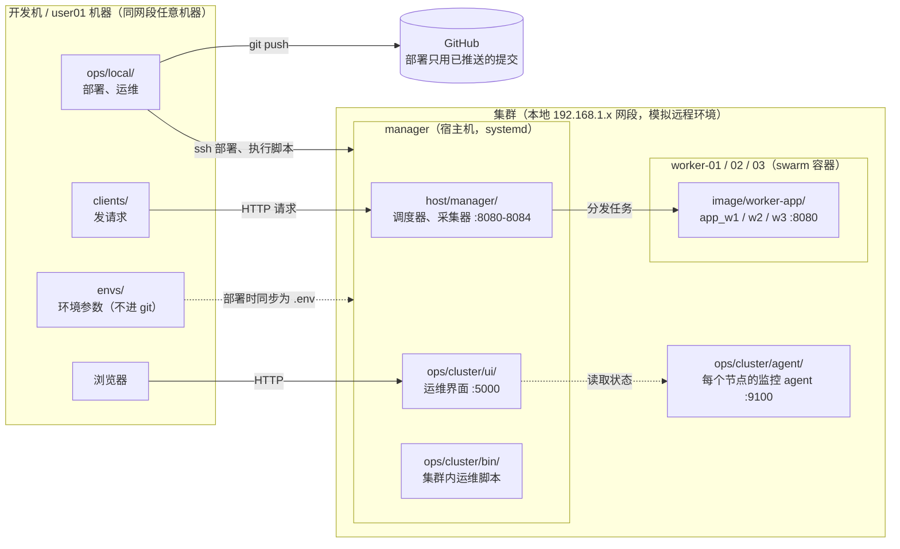
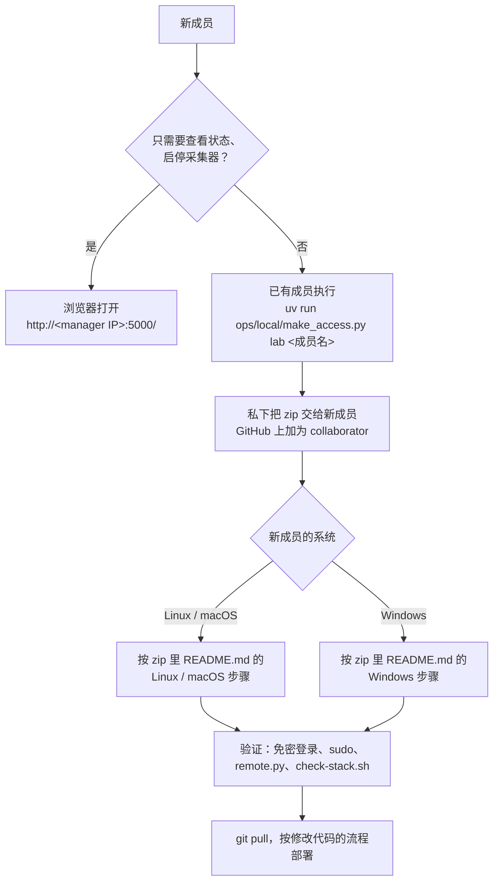
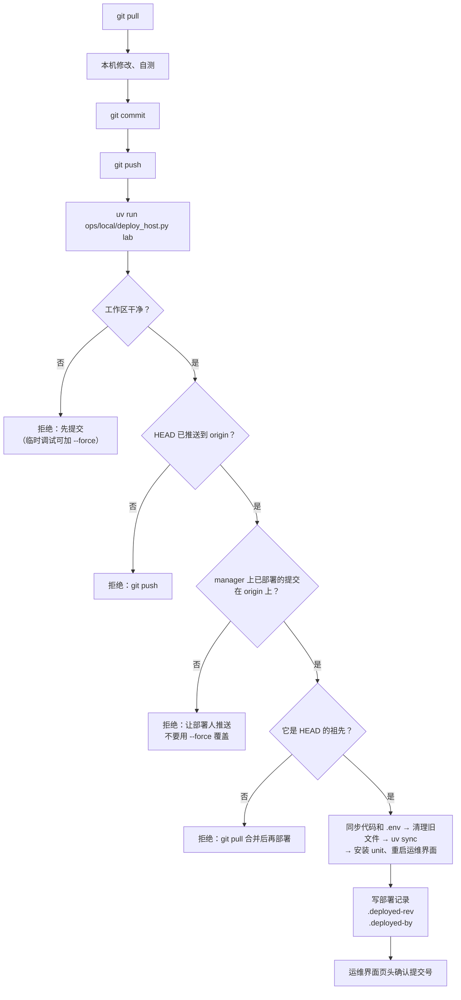

# swarm-lb

一个任务负载均衡和调度实验项目，跑在树莓派 Docker Swarm 集群上（1 个 manager、3 个 worker）。manager 上的调度器负责接收客户端请求，再按算法（RR、min_min、sd_min、DQN、RL_MOTS 等）把任务分给 worker 容器，同时采集训练数据。

- [概览](#概览)：整体结构、目录
- [首次使用](#首次使用)：新成员接入（访问包 zip，Linux / Windows）
- [一、服务器、网络与路由器](#一服务器网络与路由器)
- [二、Docker 部署与 Swarm 集群](#二docker-部署与-swarm-集群)
- [三、代码改动、部署与 GitHub](#三代码改动部署与-github)
- [四、运维管理](#四运维管理)
- [常见问题](#常见问题)
- [待办与注意](#待办与注意)

## 概览

### 整体结构



manager 上的 5 个调度器/采集器（8080–8084）**共用同一个 stack** 的 3 个 worker 容器（都在 worker 的 8080 端口），它们之间不能同时跑互相冲突的实验。

### 目录

目录按"代码在哪台机器上运行"划分：

| 路径                   | 在哪运行                     | 内容                                                                                                          |
| ---------------------- | ---------------------------- | ------------------------------------------------------------------------------------------------------------- |
| `host/manager/`        | manager 宿主机（systemd）    | 调度器 `scheduler_*.py`、数据采集器 `collector_*.py`、算法 `algorithms/`、模型 `model/` 等，见下表           |
| `host/archive/`        | —（不部署）                  | 已停用的调度器/采集器和重复文件，见 [host/archive/README.md](host/archive/README.md)                          |
| `image/worker-app/`    | worker 上的 docker 容器      | 当前 worker 服务 `app.py`（= v8.7）、`Dockerfile`，有独立的 `pyproject.toml` 和 `uv.lock`                     |
| `image/stack/`         | swarm                        | 线上 stack 定义 `collect_data_stack.yml`（镜像按 digest 锁定）                                                |
| `image/versions/`      | —（不部署）                  | worker 镜像历史版本 v5–v8.7 的 `app.py`、Dockerfile、stack，见 [image/versions/README.md](image/versions/README.md) |
| `clients/load-client/` | 集群外（开发机或user01机器） | 发请求的客户端                                                                                                |
| `ops/cluster/ui/`      | manager :5000                | 运维管理界面（aiohttp 后端加单页前端）                                                                        |
| `ops/cluster/agent/`   | 每个节点 :9100               | 节点监控 agent，只用标准库，只读                                                                              |
| `ops/cluster/systemd/` | manager 和各节点             | systemd unit 模板，`@变量名@` 在部署时用环境参数替换                                                          |
| `ops/cluster/bin/`     | manager                      | 集群内运维脚本：重建 swarm、启停 stack、构建镜像、查询队列等                                                  |
| `ops/local/`           | 开发机                       | 部署、远程执行、开通访问的 Python 脚本（`uv run` 运行，Linux / Windows 通用）；`snapshots/` 不进 git          |
| `ops/lib.sh`           | manager                      | `ops/cluster/bin/` 脚本加载 `.env` 用                                                                         |
| `envs/`                | 开发机                       | 各环境参数，只有 `example.env` 进 git                                                                         |
| `inventory.toml`       | 开发机和 manager 共用        | 节点、服务、端口归属的登记表，运维界面和部署脚本都读它                                                        |
| `data/`                | —                            | 实验日志和数据（不进 git）                                                                                    |
| `legacy/`              | —                            | 旧版本代码和数据，含旧的明文配置，只留在本机，不进 git                                                        |
| `secrets/`             | —                            | 交接给成员的访问包（私钥、ssh 配置、env 打成的 zip），只留在本机，不进 git                                    |

**规则：除 `ops/local/`、`clients/`、`envs/`、`data/`、`legacy/`、`host/archive/`、`image/versions/` 外，其余进 git 的文件都会被部署到 manager 上。**

#### `host/manager/` 里有什么

| 文件 / 目录 | 端口 | 做什么 |
| --- | --- | --- |
| `scheduler_single.py` | 8080 | **单任务调度器**：每个请求用 XGBoost 预测各 worker 的响应时间，按请求指定的算法选一个 worker 转发 |
| `scheduler_batch.py` | 8081 | **批量调度器**（user01）：一次收一批任务，预测 任务×worker 时间矩阵，一次性分配 |
| `collector_rr.py` | 8082 | **训练数据采集 · 轮询**：任务排队，按轮询预先指定 worker，超出容量就拆分 |
| `collector_lstt.py` | 8083 | **训练数据采集 · LSTT**：按最小 worker 容量拆分，不预先指定，哪个 worker 空闲给哪个 |
| `collector_hdd_tier.py` | 8084 | **训练数据采集 · 按磁盘档位**：按请求的 HDD 档位选能容纳的最小 worker，否则轮询并改派 |
| `worker_manager.py` | — | 8080–8083 共用：发现 swarm 里的 worker，通过 SSH 实测内存、磁盘 |
| `worker_manager_static.py` | — | 8084 用：worker 资源上限读配置文件，不 SSH |
| `swarm/` | — | 查询 swarm 的服务、节点、资源上限（`info.py` SSH 实测，`info_static.py` 读 `worker_hdd_limits.json`） |
| `algorithms/single/` | 8080 | `peak_milp.py`（请求名 `algor1`，最小化峰值占用）、`balance_milp.py`（`algor2`，最小化占用不均衡）、`double_dqn.py`（`dqn`）、`min_min.py`、`round_robin.py` |
| `algorithms/batch/` | 8081 | `peak_milp.py`（`algor1_set`）、`balance_milp.py`（`algor2_set`）、`rl_mots.py`（`RL-MOTS`）、`rl_mots_ablation.py`（`Ablation`，状态用等待时间代替预测时间的消融版本） |
| `model/` | — | `single_xgb.joblib`（8080）；`batch_xgb_multioutput.joblib` 及 `batch_predict.py`、`batch_preprocess.py`（8081） |
| `settings.py`、`stack_name` | — | 读 `.env` 里的 SSH 账号；stack 名 |

请求里用的算法名（`algor1`、`dqn`、`RL-MOTS` 等）没有变。

## 首次使用

同一个 192.168.1.x 网段里的任何一台机器（Linux、macOS 或 Windows），配置好之后都能像现有的开发机一样运维：部署、执行集群内脚本、发请求。GitHub 只用来同步代码；运维靠的是本机的 env 文件和 ssh 密钥，这两样都不进 git，统一放在**访问包 zip** 里交给新成员。

> 只想**查看状态、启停采集器、看日志**的话，什么都不用装，浏览器打开 `http://<manager IP>:5000/` 就行（运维界面，在同一网段内都能访问）。

开发机上的运维脚本都是 Python（`ops/local/*.py`，只用标准库），Linux、macOS、Windows（PowerShell 或 Git Bash）用法一样。**推荐装 uv**，用 `uv run` 运行：

```bash
uv run ops/local/deploy_host.py lab        # 部署
uv run ops/local/remote.py lab <脚本名>     # 在 manager 上执行集群内脚本
```

- 有 uv 就够了，本机不用另外装 Python：脚本头部写了 `requires-python = ">=3.9"`，本机没有合适的 Python 时 uv 会自动下载一个；`uv run` 运行这几个脚本时也不会安装项目依赖（pandas、torch 等），第一次运行很快。
- 没有 uv 也能用：装 Python 3.9 及以上，直接执行 `python ops/local/deploy_host.py lab`，命令的其余部分不变（Linux/macOS 上可能叫 `python3`）。Windows 上要装 python.org 的正式版本，Microsoft Store 自带的 `python` 只是一个跳转到商店的占位程序。
- 只有在本机跑客户端（`clients/`）或调试 `host/` 代码时才需要 `uv sync`，这时用的是 `pyproject.toml` 指定的 Python 3.11，uv 同样会自动下载。



### 1. 开通访问（已有成员操作）

```bash
uv run ops/local/make_access.py lab <成员名>      # 例：uv run ops/local/make_access.py lab user02
```

脚本会：

1. 在 `secrets/<成员名>-access/` 生成一把专给这个人的 ed25519 密钥（已经有就复用）；
2. 把公钥加到 4 个节点 `pi` 账号的 `authorized_keys`，并用新密钥逐个验证能登录；
3. 生成 4 个节点的 ssh 配置，复制 `envs/lab.env`，按 [ops/local/access-pack-README.md](ops/local/access-pack-README.md) 生成说明（Linux / macOS、Windows 两套步骤）；
4. 打包成 `secrets/swarm-lb-<成员名>-access.zip`。

zip 里有**私钥和密码**，要私下交给对方（当面拷贝或内网共享），不要通过 git、网盘、issue 或公开群聊发送。`secrets/` 在 `.gitignore` 里，不进 git，也不会被部署。

要部署的话，还要在 GitHub 上把对方加为仓库的 collaborator（需要 push 权限）。

### 2. 配置本机（新成员操作）

解压 zip，按里面 `README.md` 的步骤做。两种系统的区别：

| | Linux / macOS | Windows |
| --- | --- | --- |
| 需要安装 | git、[uv](https://docs.astral.sh/uv/)（不用另装 Python） | [Git for Windows](https://git-scm.com/download/win)、uv（不用另装 Python） |
| 安装 uv | `curl -LsSf https://astral.sh/uv/install.sh \| sh` | PowerShell：`powershell -ExecutionPolicy ByPass -c "irm https://astral.sh/uv/install.ps1 \| iex"` |
| 终端 | 系统自带终端 | PowerShell 或 Git Bash 都可以 |
| 私钥权限 | `chmod 600 ~/.ssh/swarm_lb_<成员名>_ed25519` | 用 `icacls` 收紧权限，否则 Windows 自带的 ssh 会拒绝使用（zip 说明里有命令） |

两边共同的步骤：私钥复制到 `~/.ssh/`（Windows 是 `C:\Users\<你>\.ssh\`），`ssh_config.txt` 追加到 `~/.ssh/config`，clone 仓库，`lab.env` 放到 `envs/lab.env`。`uv sync` 只在本机要跑客户端时才需要。

### 3. 验证

```bash
# 4 个节点都能免密登录（第一次连接会问是否信任主机指纹，输入 yes）
ssh Manager-Node hostname
ssh Worker-Node-1 hostname
ssh Worker-Node-2 hostname
ssh Worker-Node-3 hostname

ssh Manager-Node "sudo -n true && echo sudo OK"     # 部署需要 manager 上的免密 sudo（pi 账号已配置）
uv run ops/local/remote.py lab                      # 能列出 ops/cluster/bin/ 下的脚本，说明 env 文件没问题
uv run ops/local/remote.py lab check-stack.sh       # 能看到 collect_data_stack 的 3 个服务
```

全部通过后，打开 `http://<manager IP>:5000/`，确认能看到运维界面。

### 4. 第一次部署前

先不要急着部署。执行 `git pull`，然后看一眼运维界面页头的提交号，确认和你本地的 HEAD 一致或者是它的祖先。之后按[修改代码的流程](#修改代码的流程)操作。部署前的检查会挡住"覆盖别人部署"的情况，详见[多人协作](#多人协作)。

### 不用访问包、自己配置

已经知道 `pi` 的密码，也可以自己生成密钥：

```bash
ssh-keygen -t ed25519 -f ~/.ssh/swarm_lb_ed25519 -C "<你的名字>@<机器名>"
ssh-copy-id -i ~/.ssh/swarm_lb_ed25519.pub pi@<节点 IP>    # 4 个节点各执行一次（Windows 没有 ssh-copy-id，用 Git Bash 执行）
cp envs/example.env envs/lab.env                           # 逐项填写，含义见「环境参数」
```

再在 `~/.ssh/config` 里给每个节点写一段（`Host` 名必须和 env 里的 `MANAGER_SSH`、`WORKER1_SSH`…`WORKER3_SSH` 一致）：

```
Host Manager-Node
    HostName <manager IP>
    User pi
    IdentityFile ~/.ssh/swarm_lb_ed25519
    IdentitiesOnly yes
# Worker-Node-1、Worker-Node-2、Worker-Node-3 同上，只改 Host 和 HostName
```

**每人用自己的密钥，不要共用。** 这样以后有人不再参与时，只删掉他那一行公钥就行。

---

## 一、服务器、网络与路由器

### 节点

| 节点      | 角色          | IP            | swarm label | 存储                     |
| --------- | ------------- | ------------- | ----------- | ------------------------ |
| manager   | swarm manager | `$MANAGER_IP` | —           |                          |
| worker-01 | swarm worker  | `$WORKER1_IP` | type=low    | NVMe 1TB（根分区 917G）  |
| worker-02 | swarm worker  | `$WORKER2_IP` | type=middle | NVMe 1TB（根分区 917G）  |
| worker-03 | swarm worker  | `$WORKER3_IP` | type=high   | NVMe 1TB（根分区 917G）  |

所有节点都是树莓派，账号 `pi`，manager 上 `pi` 可以免密 sudo。真实 IP、MAC 只记在 `envs/<环境名>.env` 里。

### 环境参数

IP、ssh 别名、账号密码和路径等，都放在本机的 `envs/<环境名>.env` 里，**不进 git**。模板是 [envs/example.env](envs/example.env)。

- **`lab`**：本地 192.x 集群。以后接入真正的远程集群，再加一份 `prod.env` 就行，代码不用改。
- **指定环境**：所有 `ops/local/` 脚本的第一个参数都是环境名。也可以先 `export SWARM_ENV=lab`，之后就能省略。
- **同步到 manager**：部署时，这份文件会同步到 manager 的 `$REMOTE_DIR/.env`（权限 600）。manager 上的服务通过 systemd 的 `EnvironmentFile` 读取它，集群内的脚本也读它。
- **格式**：每行写 `KEY=VALUE`。**不能在行尾写注释**，systemd 不支持。
- **修改后**：要重新执行 `deploy_host.py` 才会生效；正在运行的服务还要加 `--restart`。改了共享的参数（比如 SSH 密码）时，要通知其他会部署的人同步修改自己的 env 文件。

| 变量                                                                             | 用途                                                    |
| -------------------------------------------------------------------------------- | ------------------------------------------------------- |
| `MANAGER_SSH` `MANAGER_IP`、`WORKER{1,2,3}_SSH` `WORKER{1,2,3}_IP`               | 各节点的 ssh 别名和 IP                                  |
| `MANAGER_MAC`、`WORKER{1,2,3}_MAC`、`GATEWAY_IP`                                 | 各节点 eth0 的 MAC、做地址保留的路由器，见下一节        |
| `REMOTE_USER` `REMOTE_DIR` `AGENT_DIR`                                           | 节点上的账号、本仓库在 manager 上的部署目录、agent 目录 |
| `NODE_SSH_USER` `NODE_SSH_PASSWORD`                                              | 采集器 SSH 到 worker 读取资源时用的账号                 |
| `DOCKER_IMAGE` `STACK_NAME` `STACK_COMPOSE` `DOCKER_BUILD_DIR`                   | 镜像和 stack 相关，见[第二部分](#二docker-部署与-swarm-集群) |
| `GRB_LICENSE_FILE`                                                               | 8080 用的 gurobi license                                |
| `OPS_PORT` `AGENT_PORT`                                                          | 运维界面和 agent 的端口                                 |

### 节点 IP 与路由器

节点**没有配置静态 IP**，4 台都通过 DHCP 拿地址（eth0）。IP 能固定不变，靠的是路由器（`$GATEWAY_IP`）上按 MAC 做的 **DHCP 地址保留**。env 文件、ssh 别名、swarm 节点地址、调度器访问 worker 用的都是这几个 IP，所以地址保留一旦失效，部署会连不上，swarm 节点也会掉线。

各节点的 MAC 记在 `envs/<环境名>.env` 的 `*_MAC` 里，和路由器上的保留列表对照着看。路由器的后台密码和配置导出**不要放进仓库**。

| 情况                             | 要做的事                                                                                                                                                                                                  |
| -------------------------------- | --------------------------------------------------------------------------------------------------------------------------------------------------------------------------------------------------------- |
| 换了树莓派、网卡，或者重刷了系统 | 在节点上执行 `cat /sys/class/net/eth0/address` 查新 MAC → 在路由器上把新 MAC 绑定到原来的 IP → 更新 env 里的 `*_MAC` → 重启节点，让它重新获取 IP                                                         |
| 路由器被重置或者更换             | 按 env 里的 `*_MAC`、`*_IP` 重新添加 4 条地址保留                                                                                                                                                         |
| 某个节点的 IP 已经变了           | 先改回原 IP（按上面两行处理）。如果确实要换 IP：修改 `envs/*.env` 和每个人的 `~/.ssh/config`，执行 `deploy_host.py <环境> --restart` 和 `deploy_agents.py`；manager 的 IP 变了还要重建 swarm             |
| 新增节点                         | 先在路由器上做好地址保留，再加入 swarm、打 label，在 env 和 `inventory.toml` 里登记                                                                                                                       |

### worker 磁盘

- 容器的 `/app/data` 挂载的是 worker 上的 `/mnt/storage/collect_app_v8`。它**只是根分区上的一个普通目录**，不是单独的盘或分区，也没有配额，容器能写满整个 917G 根分区。
- 各节点的"磁盘容量"（low 5G、middle 10G、high 25G）只是调度器里的数值约束，写在 [host/manager/swarm/worker_hdd_limits.json](host/manager/swarm/worker_hdd_limits.json)（8084 用），调度时用来判断任务能不能放到某个节点，**容器本身不受限制**。
- worker 容器启动时会清空 `/app/data`，平时那个目录是空的。

### ssh 访问与成员管理

- 每个人用自己的 ssh 密钥，公钥加在 4 个节点的 `~pi/.ssh/authorized_keys` 里。新成员用 `uv run ops/local/make_access.py lab <成员名>` 开通，见[首次使用](#首次使用)。
- **有人不再参与时：**
  1. 在 4 个节点上删掉他那一行公钥（行尾注释就是生成时 `-C` 写的 `<名字>@<机器名>`）：
     ```bash
     for h in Manager-Node Worker-Node-1 Worker-Node-2 Worker-Node-3; do
       ssh $h "sed -i '/<名字>@<机器名>\$/d' ~/.ssh/authorized_keys"
     done
     ```
  2. 在 GitHub 上移除他的 collaborator 权限。
  3. 他手里有 `lab.env`，里面有 `NODE_SSH_PASSWORD` 等密码。需要的话修改这些密码，更新自己的 env 文件，执行 `deploy_host.py lab --restart`，并通知其他成员同步修改。
- **不要共用一把私钥**：没法单独撤销某个人的权限，也查不出是谁部署的。

---

## 二、Docker 部署与 Swarm 集群

### 线上 stack

stack 名是 `collect_data_stack`，定义在 [image/stack/collect_data_stack.yml](image/stack/collect_data_stack.yml)。3 个服务各 1 个副本，按 label 固定在一台 worker 上：

| 服务     | 节点（label）          | CPU 上限 | 内存上限 |
| -------- | ---------------------- | -------- | -------- |
| `app_w1` | worker-01（type=low）    | 0.6      | 2G       |
| `app_w2` | worker-02（type=middle） | 1.0      | 2G       |
| `app_w3` | worker-03（type=high）   | 0.6      | 1G       |

三个服务共用的配置：

- **镜像**：`${DOCKER_IMAGE}@sha256:7eca5baf…`，按 digest 锁定，就是 [v8.7](image/versions/README.md)。源码在 [image/worker-app/](image/worker-app/)。
- **端口**：容器 8080 以 `mode: host` 发布到所在节点的 8080，不走 swarm 路由网格。调度器直接访问 `<worker IP>:8080`，所以每台 worker 只能跑一个副本。
- **数据卷**：节点 `/mnt/storage/collect_app_v8` → 容器 `/app/data`（见[worker 磁盘](#worker-磁盘)）。
- **网络**：overlay 网络 `collect_data_network`。

### 判断容器跑的是哪个版本

看**镜像 digest + stack yaml**，不要只看 tag。`collect_data_app:v8` 这个 tag 前后被覆盖过 7 次（v8.1–v8.7），各版本的区别和镜像 ID 见 [image/versions/README.md](image/versions/README.md)。

```bash
uv run ops/local/remote.py lab check-stack.sh                       # stack 和 service 状态
ssh Worker-Node-1 'sudo docker inspect $(sudo docker ps -q --filter name=collect_data_stack | head -1) --format "{{.Image}}"'
```

2026-11-11 核对过：三台 worker 上运行的都是 v8.7（镜像 ID `be79b0596cb2`），Docker Hub 上 `:v8` 也指向这个 digest，和 `collect_data_stack.yml` 一致。

### 常用操作

都在 manager 上执行，从开发机用 `remote.py` 调用。**这些操作会影响所有正在跑的实验，执行前先确认没有人在采集数据。**

| 操作                      | 命令                                          | 说明                                                                                  |
| ------------------------- | --------------------------------------------- | ------------------------------------------------------------------------------------- |
| 查看 stack                | `uv run ops/local/remote.py lab check-stack.sh`      |                                                                                       |
| 部署或更新 stack          | `uv run ops/local/remote.py lab stack-start.sh`      | 用 env 里的 `STACK_COMPOSE`，即本仓库的 `collect_data_stack.yml`                      |
| 删除 stack                | `uv run ops/local/remote.py lab stack-stop.sh`       | 3 个 worker 容器都会停                                                                |
| 构建并推送镜像            | `uv run ops/local/remote.py lab build-image.sh v9`   | 必须给新 tag，已存在的 tag 拒绝覆盖；推送后打印 digest，见[发布新的 worker 版本](#发布新的-worker-版本) |
| 重建 swarm                | `uv run ops/local/remote.py lab rebuild-swarm.sh`    | 交互式，要输入各 worker 的密码；会自动按 `inventory.toml` 恢复节点 label，再部署 stack |
| 给节点打 label            | `ssh Manager-Node 'docker node update --label-add type=low worker-01'` | 重新加入 swarm 的节点没有 label，服务会一直 pending                       |

### 发布新的 worker 版本

1. 修改 [image/worker-app/app.py](image/worker-app/app.py)，提交、推送、`deploy_host.py`。
2. `uv run ops/local/remote.py lab build-image.sh v9`：构建并推送**新 tag**，脚本会打印 digest。
3. 把 env 里的 `DOCKER_IMAGE` 改成新 tag，`collect_data_stack.yml` 里的 digest 改成新的，提交、推送、`deploy_host.py`，再 `stack-start.sh`。
4. 在 [image/versions/](image/versions/) 里补上这个版本的记录。

---

## 三、代码改动、部署与 GitHub

### 修改代码的流程



```bash
git pull                             # 1. 先拉取：别人可能已经部署了新代码
# 2. 在本机修改、自测
git add -A && git commit -m "..."    # 3. 提交
git push                             # 4. 推送：部署脚本只接受已推送的提交
uv run ops/local/deploy_host.py lab         # 5. 部署（改了哪部分对应哪个命令，见下面的表）
```

部署后看运维界面 `http://$MANAGER_IP:5000/` 的页头，显示的提交号应该是你刚推送的那个。

**不要直接在 manager 上改代码。** 下次部署会覆盖这些改动，而且 git 里查不到。`~/appv8`、`~/apps` 是旧目录，已经没有服务从那里运行，在那里改代码不会生效。

### 调试还没提交的代码

```bash
uv run ops/local/deploy_host.py lab --force   # 部署工作区当前的内容（包括未提交的改动）
```

`--force` 会跳过所有部署前检查，只用于临时调试。部署记录里写的仍然是 HEAD 的提交号，所以调试完一定要提交、推送，再正常部署一次，让 manager 上的代码和 git 一致。

### 各部分怎么部署

| 改了什么                                 | 怎么部署                                                                       | 说明                                                                                            |
| ---------------------------------------- | ------------------------------------------------------------------------------ | ----------------------------------------------------------------------------------------------- |
| 运维界面 `ops/cluster/ui/`（前端或后端） | `uv run ops/local/deploy_host.py lab`                                                 | 每次部署都会自动重启运维界面，刷新浏览器即可                                                    |
| 调度器和采集器 `host/manager/`           | `uv run ops/local/deploy_host.py lab --restart`                                       | 会重启正在运行的采集器。没在运行的，下次在运维界面启动时就是新代码                              |
| systemd unit `ops/cluster/systemd/`      | `uv run ops/local/deploy_host.py lab`，正在运行的服务还要加 `--restart`               | 脚本会提示哪些服务需要重启；被替换的旧 unit 会备份到 manager 的 `~/swarm-bak/systemd/<时间戳>/` |
| `inventory.toml`                         | `uv run ops/local/deploy_host.py lab`                                                 | 运维界面每次请求都会重新读取                                                                    |
| Python 依赖 `pyproject.toml`             | 先执行 `uv lock`，把 `uv.lock` 一起提交，再 `deploy_host.py lab --restart`     | manager 上的 `uv sync` 用的是 `--frozen`，锁文件没提交会报错                                    |
| 节点 agent `ops/cluster/agent/`          | `uv run ops/local/deploy_agents.py lab`                                               | 部署到所有节点；只部署某几个节点：`deploy_agents.py lab Worker-Node-1 Worker-Node-2`            |
| 集群内脚本 `ops/cluster/bin/`            | 先 `deploy_host.py lab`，再执行 `uv run ops/local/remote.py lab <脚本名>`             | 见[集群内脚本](#集群内脚本)                                                                     |
| worker 镜像、stack `image/`              | 见[发布新的 worker 版本](#发布新的-worker-版本)                                |                                                                                                 |
| 客户端 `clients/`                        | 不用部署                                                                       | 在本机运行：`SWARM_ENV=lab uv run python clients/load-client/client.py`                         |
| 环境参数 `envs/lab.env`                  | `deploy_host.py lab`，正在运行的服务还要加 `--restart`                         | 这个文件不进 git                                                                                |

### `deploy_host.py` 做了什么

1. **检查**：工作区是否干净、HEAD 是否已推送、manager 上已部署的提交是不是 HEAD 的祖先（见[多人协作](#多人协作)）。
2. **同步**：把代码同步到 manager 的 `$REMOTE_DIR`，同时同步环境参数，生成 `$REMOTE_DIR/.env`。
3. **清理旧文件**：删除上次部署过、这次已经不存在的文件（按 `.deployed-files` 清单）。`.venv`、`.env` 和不是脚本部署的文件都不会动。
4. **安装依赖**：`uv sync --frozen`，只装 manager 需要的 host、algo、ui 三组。
5. **安装 unit**：在本机渲染 unit 模板，只安装 `inventory.toml` 里登记为 `managed=true` 的 unit（不看 owner），然后重启运维界面。加了 `--restart` 时，还会重启正在运行的采集器。
6. **记录**：写下 `.deployed-rev`（提交）和 `.deployed-by`（谁、什么时候、从哪台机器）。

脚本**不会**做这些事：

- 不改采集器的开机自启状态。需要时自己在 manager 上执行 `systemctl enable` 或 `disable`。
- 不删除已经改名或移除的 unit。unit 改名后，要在 manager 上手动 `disable` 并删除旧 unit。
- 不碰 `~/appv8`、`~/apps` 和它们的 venv（旧目录，留着备查）。

### 多人协作

- **只通过 git 修改远程代码。** 每个人都用自己的 `envs/<环境名>.env` 和自己的 ssh 密钥部署。
- **部署前的检查**，可以避免互相覆盖：
  | 检查 | 不通过时 | 怎么处理 |
  |---|---|---|
  | 工作区有未提交的改动 | 拒绝部署 | 先提交；临时调试可以加 `--force` |
  | HEAD 还没推送到 origin | 拒绝部署 | `git push` |
  | manager 上的提交"不是 HEAD 的祖先" | 拒绝部署 | 别人在你之后部署过：先 `git pull` 合并，再部署 |
  | manager 上的提交"不在 origin 上" | 拒绝部署 | 有人部署了没推送的代码：在运维界面页头悬停看到部署人，让对方推送。**不要直接用 `--force` 覆盖** |
- **查看当前部署**：看运维界面页头（悬停可以看到部署人和时间），或者执行 `ssh Manager-Node 'cat ~/swarm-lb/.deployed-rev ~/swarm-lb/.deployed-by'`。
- **不用 GitHub Actions 自动部署**：可以在网段内装 self-hosted runner 实现"push 即部署"，但这样 env 文件和 ssh 密钥就要放进 runner 或 GitHub Secrets 里，暴露面更大。现在的手动部署已经有部署前检查和部署记录，暂时不需要。

### 回滚

- **代码回滚**：用 `git revert` 生成一个新提交，推送后正常部署。不要 checkout 旧提交再部署，那样会被祖先检查拦住；就算用 `--force` 部署成功，也会让别人的下一次部署被拦住。
- **systemd unit**：被替换的旧文件在 manager 的 `~/swarm-bak/systemd/<时间戳>/`，复制回 `/etc/systemd/system/`，执行 `sudo systemctl daemon-reload`，再重启对应服务。
- **worker 镜像**：把 `collect_data_stack.yml` 里的 digest 改回旧版本（worker 上还留着 v8.1–v8.7 的镜像，见 [image/versions/](image/versions/)），再 `stack-start.sh`。
- **2026-11-04 的目录重排**：manager 上的旧布局备份在 `~/swarm-bak/old-layout-20261104-224904/`。

### 依赖

根目录只有一份 `uv.lock`，按运行位置分组安装：

| 运行位置   | 安装命令                                                                                        |
| ---------- | ----------------------------------------------------------------------------------------------- |
| manager    | `uv sync --no-default-groups --group host --group algo --group ui`（`deploy_host.py` 自动执行） |
| 客户端机器 | `uv sync --no-default-groups --group client`                                                    |
| 开发机     | `uv sync`（装 host、ui、client）；要用算法依赖时执行 `uv sync --all-groups`                     |

| 分组     | 给谁用                                                    |
| -------- | --------------------------------------------------------- |
| `host`   | `host/manager/` 的采集器                                  |
| `algo`   | 8080/8081 的调度算法（torch、gurobi、xgboost 等）          |
| `ui`     | 运维界面                                                  |
| `client` | `clients/`                                                |

docker 镜像在 `image/worker-app/` 下有自己的 `pyproject.toml`。agent 只用标准库，直接用系统的 `python3`。

Python 版本锁定为 3.11，和 manager 系统的 Python 3.11.2 保持一致。

---

## 四、运维管理

### 运维界面

浏览器打开 `http://$MANAGER_IP:5000/`（同网段都能访问，不需要登录）：

- **总览**：各节点的 CPU、内存、磁盘（来自每个节点的 agent :9100，含 30 分钟内存历史），swarm 服务和容器状态，页头显示当前部署的提交和部署人。
- **服务**：`inventory.toml` 里登记的 systemd 服务。可以启动、停止、重启、看日志：
  - `managed = true`（unit 由本仓库管理）的服务都可以操作；
  - 操作别人（`owner` 不等于 `[cluster].maintainer`，目前是 `soar009`）的服务会弹窗确认，**操作前先和对方打招呼**；
  - 没有 `managed` 的服务只读，任何脚本都不能修改它的 unit、venv 或代码目录。
- 停止、重启要点两次确认。
- 运维界面**不管 swarm stack**：启停 worker 容器、改资源都要用[第二部分](#二docker-部署与-swarm-集群)的脚本。

### 服务与端口

完整信息以 [inventory.toml](inventory.toml) 为准。

| 端口           | unit             | 归属    | 脚本 `host/manager/`                                             | 开机自启           |
| -------------- | ---------------- | ------- | ---------------------------------------------------------------- | ------------------ |
| 5000           | `swarm-lb-ops`   | soar009 | 运维界面 `ops/cluster/ui/server.py`                              | 是                 |
| 9100           | `swarm-lb-agent` | soar009 | 节点 agent，每个节点一份                                         | 是                 |
| 8080           | `collect_8080`   | soar009 | `scheduler_single.py`：单任务调度器                              | 否，需要时手动启动 |
| 8081           | `collect_8081`   | user01  | `scheduler_batch.py`：批量调度器。启停前先问 user01              | 否                 |
| 8082           | `collect_8082`   | soar009 | `collector_rr.py`：训练数据采集 · 轮询                           | 是                 |
| 8083           | `collect_8083`   | soar009 | `collector_lstt.py`：训练数据采集 · LSTT                         | 是                 |
| 8084           | `collect_8084`   | soar009 | `collector_hdd_tier.py`：训练数据采集 · 按磁盘档位               | 是                 |
| 8080（worker） | swarm 服务       | soar009 | worker 容器 `image/worker-app/app.py`                            | 由 swarm 管理      |

各文件做什么见[目录](#目录)里的 `host/manager/` 表。停用的旧版本在 [host/archive/](host/archive/)。

### 集群内脚本

`ops/cluster/bin/` 里的脚本在 manager 上运行，从开发机通过 `remote.py` 调用：

```bash
uv run ops/local/remote.py lab                         # 列出全部脚本
uv run ops/local/remote.py lab check-queue.sh 8084     # 查询某个采集器的任务队列
uv run ops/local/remote.py lab check-stack.sh          # 查看 stack 和 service 状态
uv run ops/local/remote.py lab list-collect-units.sh   # 列出采集器的 systemd 状态
uv run ops/local/remote.py lab --sudo setup-udisk.sh   # 以 root 运行
```

stack 和镜像相关的脚本见[第二部分的常用操作](#常用操作)。启停或重启单个服务，最方便的是用运维界面。也可以直接在 manager 上执行 `sudo systemctl start|stop|restart <unit>`。

### 日志与数据

| 内容                       | 位置                                                                          |
| -------------------------- | ----------------------------------------------------------------------------- |
| 采集器、调度器的 stdout    | 运维界面的日志按钮，或 `ssh Manager-Node 'journalctl -u collect_8084 -n 100'` |
| 调度器的事件日志           | manager 的 `~/swarm-lb/host/manager/log/`                                     |
| 迁移前（`~/appv8`）的日志  | manager 的 `~/appv8/manager/log/`                                             |
| 运维界面                   | `journalctl -u swarm-lb-ops`                                                  |
| 实验数据                   | 本机 `data/`（不进 git）                                                      |

---

## 常见问题

| 现象                                        | 原因和处理                                                                                                                         |
| ------------------------------------------- | ---------------------------------------------------------------------------------------------------------------------------------- |
| `错误：未指定环境` 或 `找不到 envs/xxx.env` | 脚本第一个参数要写环境名，或者先设置 `SWARM_ENV`；env 文件从 `envs/example.env` 复制                                               |
| `… 缺少：XXX`                               | 你的 env 文件比 `example.env` 少了变量，对照模板补上                                                                               |
| `sudo: a password is required`              | manager 上的 `pi` 用户要能免密 sudo                                                                                                |
| 部署后运维界面打不开                        | 在 manager 上看日志：`journalctl -u swarm-lb-ops -n 50`                                                                            |
| 采集器连不上 worker 的 SSH                  | 检查 env 里的 `NODE_SSH_USER`、`NODE_SSH_PASSWORD`，改完后重新部署并加 `--restart`                                                 |
| `uv sync --frozen` 报错                     | `pyproject.toml` 改了但没执行 `uv lock`，或者 `uv.lock` 没提交                                                                     |
| 突然 ssh 超时、运维界面上某个节点离线       | 先 `ping` 该节点的 IP；如果不通，到路由器的 DHCP 客户端列表里按 MAC 找它现在的 IP，见[节点 IP 与路由器](#节点-ip-与路由器)         |
| swarm 服务一直 `0/1`、任务 pending          | 多半是节点没有 `type` label，`docker node inspect <节点> --format '{{.Spec.Labels}}'` 检查，缺了就补上（见[常用操作](#常用操作)） |
| 客户端提示 `未找到 MANAGER_IP`              | 设置 `SWARM_ENV=lab`；在user01机器上，也可以在 `clients/load-client/.env` 里写一行 `MANAGER_IP=...`                                |

## 待办与注意

- **2026-11-11 整理**：8081、8083 已迁入本仓库运行；`host/manager/` 按内容改名（`scheduler_*`、`collector_*`、`algorithms/`、`swarm/` 等，见[目录](#目录)），unit `collect_8082_rr` 改名为 `collect_8082`；开发机脚本改写为 Python（`ops/local/*.py`），Windows 不再需要 Git Bash；停用的代码移到 `host/archive/`；worker 镜像历史整理到 `image/versions/`。
- **2026-11-11 stack 和镜像改用本仓库**：`STACK_COMPOSE` 改为 `image/stack/collect_data_stack.yml`，`DOCKER_BUILD_DIR` 改为 `image/worker-app`，去掉了 `REBUILD_COMPOSE`（原来指向 v5 时期的旧配置）。`rebuild-swarm.sh` 改为部署同一个 stack 并恢复节点 label；`build-image.sh` 不再覆盖已有 tag。**其他人要同步修改自己的 `envs/lab.env`**（这三行，见 `example.env`）。
- **用本仓库重新构建的镜像和 v8.7 不完全相同**：v8.7 是 `pip install` 不锁版本装的（aiohttp 3.13.3），本仓库的 `uv.lock` 是 aiohttp 3.14.5。只影响以后新构建的镜像，线上按 digest 锁定在 v8.7 不受影响。
- **3 份 `hdd_config.json` 的内存值不一致**：实际生效的是 `host/manager/swarm/worker_hdd_limits.json`（只有磁盘值）；`clients/load-client/hdd_config.json` 里 worker-02 写的是 1G，线上是 2G。
- **安全**：2026-11-04 重写过 git 历史，去掉了明文密码和 IP。但仓库公开期间可能已经被别人拿到，建议修改各节点 `pi` 用户的密码，并同步更新 env 文件。
- **路由器**：还没有确认路由器上确实做了 4 条 DHCP 地址保留，也还没有记录谁有后台权限。确认后在这里写上负责人（不写密码）。
